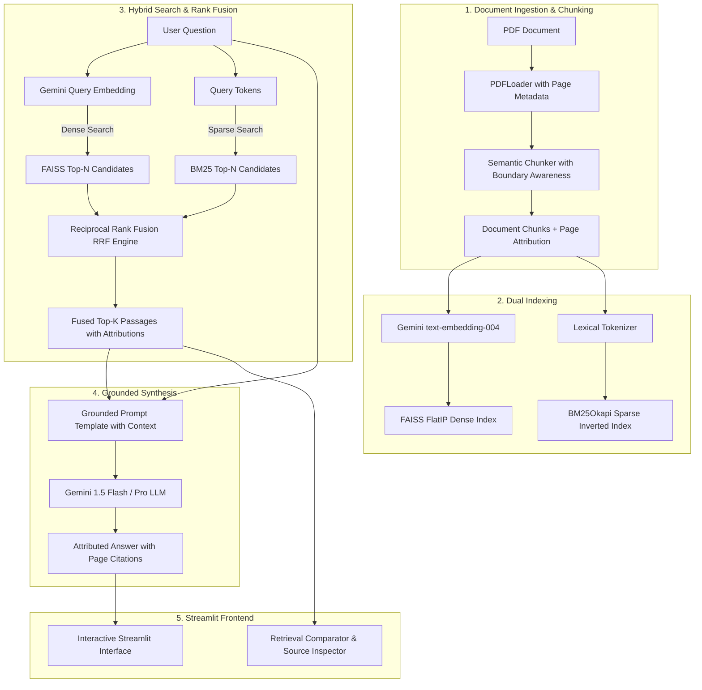

# ⚡ LLM-Powered Hybrid RAG PDF Q&A System

[](https://www.python.org/)
[](https://github.com/facebookresearch/faiss)
[](https://github.com/dorianbrown/rank_bm25)
[](https://ai.google.dev/)
[](https://streamlit.io/)
[](LICENSE)

> **Key Accomplishments**:
> - Designed a hybrid retrieval pipeline combining **FAISS semantic search** with **BM25 keyword search**, fused via **Reciprocal Rank Fusion (RRF)** for higher precision.
> - Generated **grounded, source-attributed answers** using the **Gemini API** over semantically chunked PDF content, deployed through a **Streamlit interface**.

---

## 📌 Architecture Overview

Traditional RAG systems typically rely solely on dense embeddings, which can fail on exact keyword lookups, product IDs, technical jargon, and acronyms. Conversely, pure keyword search fails on semantic intent and synonymy.

This project combines the strengths of both paradigms into a production-grade **Hybrid Retrieval Pipeline**:



---

## 🧮 How Reciprocal Rank Fusion (RRF) Works

Standard score normalization between vector cosine similarities ($[0, 1]$) and BM25 scores ($[0, \infty)$) is brittle and sensitive to corpus distribution. **Reciprocal Rank Fusion (RRF)** solves this by operating directly on the positional ranks of documents across both retrieval methods:

$$RRF\_Score(d) = \sum_{m \in M} \frac{w_m}{k + rank_m(d)}$$

Where:
- $M = \{\text{FAISS}, \text{BM25}\}$: The set of retrieval models.
- $rank_m(d)$: The 1-based rank position of document $d$ in system $m$.
- $k$: The smoothing constant (default: `60`), which dampens the advantage of documents ranked near the top.
- $w_m$: Weighting factor (governed by hyperparameter $\alpha \in [0.0, 1.0]$):
  - $w_{\text{dense}} = 2 \cdot \alpha$
  - $w_{\text{sparse}} = 2 \cdot (1 - \alpha)$

### Why RRF Achieves Higher Precision:
1. **Consensus Boosting**: Passages discovered by *both* FAISS and BM25 automatically receive an additive score boost.
2. **Resilience to Dense Blind Spots**: Specialized vocabulary (codes, product names, acronyms) missed by dense embeddings are rescued by BM25.
3. **Resilience to Keyword Stuffing**: Dense similarity prevents documents with irrelevant repeated keywords from overwhelming the ranking.

---

## 🚀 Key Features

- **Semantic-Aware PDF Chunking**: Splits text along sentence and paragraph boundaries with sliding window overlaps while strictly preserving page-level source metadata.
- **FAISS Dense Vector Store**: Inner Product (`IndexFlatIP`) search over normalized Gemini embeddings (`text-embedding-004`).
- **BM25Okapi Lexical Search**: Full-text inverted index for lexical precision and exact keyword matches.
- **Configurable RRF Engine**: Tune smoothing constant $k$ and dense/sparse balance $\alpha$ in real time.
- **Grounded Answer Generation**: Strictly conditioned Gemini prompt instructions prevent hallucination and format citations as `[Page X]`.
- **Side-by-Side Comparator Tab**: Compare Dense, Sparse, and Fused RRF rankings side-by-side on any arbitrary query.
- **Corpus & Chunk Browser**: Inspect indexed chunks, character distributions, and page mappings.

---

## 📂 Project Structure

```
hybrid-rag-pdf-qa/
│
├── app.py                     # Streamlit web application & user interface
├── requirements.txt           # Production dependencies
├── .env.example               # Template for API credentials
├── .gitignore                 # Git ignore configuration
├── test_pipeline.py           # Unit & integration verification script
├── README.md                  # System architecture & documentation
│
└── rag/                       # Core RAG engine modules
    ├── __init__.py            # Package initialization & exports
    ├── pdf_loader.py          # PDF extraction & semantic chunker
    ├── embeddings.py          # Gemini embedding generator (batch & normalize)
    ├── vector_store.py        # FAISS FlatIP vector indexing & persistence
    ├── bm25_retriever.py      # BM25Okapi sparse lexical retriever
    ├── hybrid_retriever.py    # Reciprocal Rank Fusion (RRF) fusion logic
    └── generator.py           # Grounded Gemini synthesis & citation formatter
```

---

## 🛠️ Quickstart & Setup

### 1. Clone the Repository
```bash
git clone https://github.com/khsl07/hybrid-rag-pdf-qa.git
cd hybrid-rag-pdf-qa
```

### 2. Create and Activate a Virtual Environment
```bash
# On Linux/macOS:
python3 -m venv venv
source venv/bin/activate

# On Windows:
python -m venv venv
venv\Scripts\activate
```

### 3. Install Dependencies
```bash
pip install -r requirements.txt
```

### 4. Configure Gemini API Key
Create a `.env` file in the root directory (or input it directly via the Streamlit UI sidebar):
```bash
cp .env.example .env
```
Edit `.env`:
```env
GEMINI_API_KEY=your_gemini_api_key_here
```
*(You can obtain a free Gemini API key from [Google AI Studio](https://aistudio.google.com/)).*

### 5. Run Verification Tests
```bash
python test_pipeline.py
```

### 6. Launch the Streamlit Web Application
```bash
streamlit run app.py
```
Open your browser at `http://localhost:8501`.

---

## 💻 Usage Guide

1. **Upload Document**: Drag and drop any PDF into the sidebar.
2. **Index**: Click **🚀 Index Document(s)**. The pipeline extracts text, creates semantic chunks, generates Gemini embeddings, indexes vectors in FAISS, and builds the BM25 inverted index.
3. **Ask Questions**: Type your query in the chat input.
4. **Inspect Attributions**: Expand **🔍 Retrieved Sources & Attributions** below any response to inspect:
   - Specific page numbers and source documents
   - RRF score and rank
   - Whether the chunk was retrieved via FAISS, BM25, or both
5. **Compare Modes**: Switch to the **⚖️ Hybrid vs Dense vs Sparse Comparator** tab to visualize how RRF fuses dense and sparse candidates.

---

## 👤 Author

- **GitHub**: [@khsl07](https://github.com/khsl07)

---

## 📄 License

This project is licensed under the MIT License - see the [LICENSE](LICENSE) file for details.
